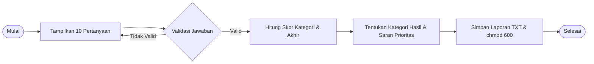

# 📐 Desain Algoritma, Flowchart, & Aturan Scoring

> **Penanggung Jawab:** Rizal Oky Alghifari (`4332611027`) — *System & Algorithm Designer*

---

## 1. Flowchart Alur Utama Program
Diagram alur eksekusi **Cyber Hygiene Scorecard** sesuai rancangan proposal:



*(Silakan diperluas dengan detail perulangan 1–10 pertanyaan pada tahap desain).*

---

## 2. Pseudocode Program
```text
BEGIN CyberHygieneScorecard
    // TODO (Rizal): Tuliskan pseudocode lengkap dari input 10 pertanyaan,
    // validasi pilihan, penjumlahan poin per kategori, hingga penentuan rekomendasi.
END
```

---

## 3. Spesifikasi Rumus Perhitungan
* **Poin per Jawaban:** Aman = `2`, Kadang-kadang = `1`, Kurang aman = `0`
* **Poin Maksimum per Kategori (2 pertanyaan):** `4` poin
* **Poin Maksimum Total (10 pertanyaan):** `20` poin
* **Skor Kategori:** `(Poin Kategori / 4) * 100`
* **Skor Akhir:** `(Total Poin / 20) * 100`
* **Klasifikasi:**
  * `80 - 100` -> **Baik**
  * `60 - 79`  -> **Cukup**
  * `0 - 59`   -> **Perlu Ditingkatkan**
* **Penanganan Skor Terendah Seri (*Tie*):** Jika lebih dari satu kategori memiliki nilai minimum yang sama, tampilkan rekomendasi untuk seluruh kategori terendah tersebut.
